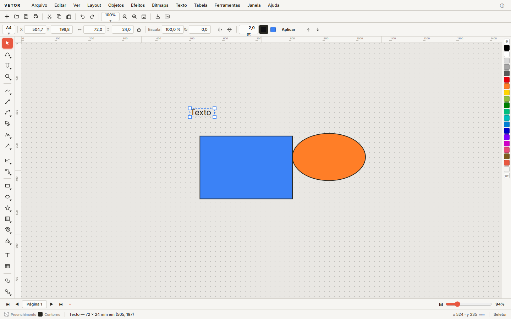
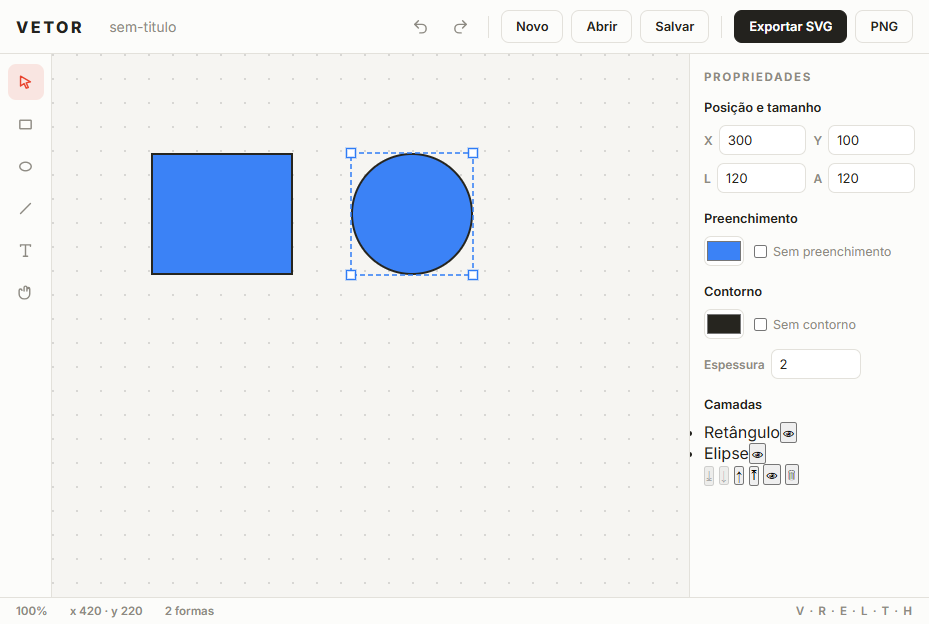

# VETOR

**Editor vetorial, direto no navegador.** Formas, texto e cores em SVG — sem instalar nada, de graça.

**[→ Abrir o editor](https://cleciodivi.github.io/vetor/editor.html)** · [Vitrine](https://cleciodivi.github.io/vetor/) · [GitHub](https://github.com/cleciodivi/vetor)

<p align="center">
  <a href="https://cleciodivi.github.io/vetor/editor.html"></a>
  <a href="https://github.com/cleciodivi/vetor/actions/workflows/tests.yml"></a>
  <a href="LICENSE"></a>
</p>

<p align="center">
  
</p>

<p align="center">
  
</p>

> Feito para quem quer desenhar logos, cartões e diagramas rápidos sem abrir um software pesado. Abre no navegador, desenha, exporta SVG ou PNG.

---

## Por quê

Editores vetoriais são ou pagos e pesados (CorelDRAW, Illustrator) ou complexos (Inkscape). O **VETOR** é o contrário: leve, aberto e pensado para o básico bem-feito — desenhar e exportar em segundos.

- **100% no navegador** — sem instalação, sem conta, sem telemetria
- **SVG nativo** — o que você desenha é SVG de verdade, exportável para qualquer lugar
- **Código simples** — vanilla JS sem dependências, fácil de ler e contribuir
- **Em português** — interface direto para o público BR

## Funciona agora

| Ferramenta | Descrição |
|---|---|
| Selecionar (V) | Clique para selecionar, arraste para mover |
| Retângulo (R) | Arraste para criar |
| Elipse (E) | Arraste para criar |
| Linha (L) | Clique e arraste entre dois pontos |
| Texto (T) | Clique e escreva (edição no painel) |
| Redimensionar | Arraste as alças de canto da forma selecionada |
| Camadas | Lista de objetos: renomear, ocultar, reordenar (⤓↓↑⤒) |
| Caneta (P) | Cliques = nós; arraste = tangente; Enter fecha, Esc cancela |
| Zoom | Roda do mouse (ancora no cursor) |
| Mover tela (H) | Arraste a área de desenho |
| Desfazer/Refazer | Ctrl+Z / Ctrl+Y (até 60 passos) |
| Salvar/Abrir | Arquivo `.json` próprio |
| Exportar | **SVG** e **PNG 1600×1200** |

## Rodando

Abra a vitrine (`index.html`) ou o editor direto (`editor.html`) no navegador — ou sirva a pasta por qualquer servidor estático:

```bash
# com Python
python -m http.server 8080
# ou com Node
npx serve .
```

Depois acesse `http://localhost:8080`.

### Testes

```bash
node tests/test-editor.js
```

## Estrutura

```
vetor/
├── index.html            # Vitrine (hero, galeria, recursos, CTA)
├── editor.html           # Editor completo (topbar / ferramentas / mesa / painel)
├── favicon.svg
├── assets/
│   ├── css/
│   │   ├── site.css      # Tema da vitrine
│   │   └── styles.css    # Tema do editor
│   └── js/
│       ├── editor.js     # Núcleo: modelo, seleção, histórico, SVG
│       └── app.js        # UI: renderização, eventos, arquivos
├── docs/                 # Capturas de tela usadas no README/vitrine
└── tests/
    └── test-editor.js    # Testes do núcleo (Node)
```

## Roadmap

- [x] MVP: formas, seleção, mover, cores, zoom/pan, exportar SVG/PNG
- [x] Redimensionar pela alça da seleção
- [x] Camadas (lista de objetos, reordenar, ocultar)
- [x] Caneta com curvas Bézier (cliques = nós, arraste = tangente, Enter fecha, Esc cancela)
- [ ] Edição de nós de path existente (tangentes arrastáveis fora do modo caneta)
- [ ] Grade, guias e alinhamentos
- [ ] Agrupar/desagrupar
- [ ] Copiar/colar/duplicar (Ctrl+C/V/D)
- [ ] Importar SVG
- [ ] Atalhos estilo Corel (F6 retângulo, F7 elipse…)

## Contribuindo

Toda ajuda é bem-vinda — code, teste, tradução, design ou ideia.

1. Abra uma issue descrevendo o que quer fazer (ou pegue uma aberta)
2. Faça um fork e um branch (`feat/minha-feature`)
3. Envie o pull request

Tente manter o código do jeito que está: JS vanilla, sem build, sem dependências — é o que mantém o projeto simples de contribuir.

## Licença

[MIT](LICENSE)

---

Feito no navegador, para o navegador. 🧡